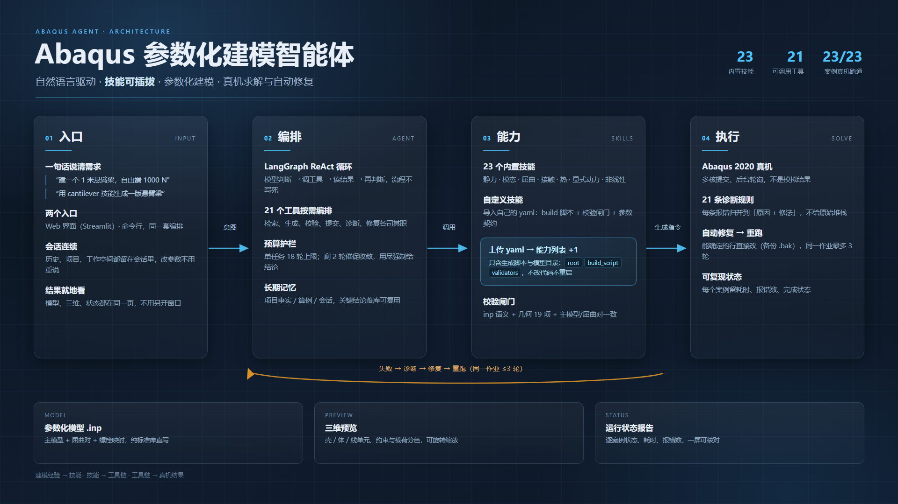

# Abaqus Agent —— 参数化建模智能体

用自然语言驱动 Abaqus：**说需求 → 它选技能 → 生成模型 → 跑校验闸门 → 提交求解 → 出错自动诊断并修复**。

它不是又一个建模工具，而是在参数化建模之上加了一层 **工具调用 + 记忆 + 编排**：
把"参数可行域、易错点、验收标准"这些散落在人脑里的经验，固化成 agent 每次都会执行的闸门，
再用大模型把"调哪个工具、参数怎么填"这一步交给自然语言。

<p align="center">
  
</p>

**2 分钟演示视频**（架构讲解 + 导入技能 + 真机跑通）：
[下载观看](https://github.com/cyf011588/abaqus-agent/releases/latest/download/demo.mp4)

---

## 它解决什么

传统 CAE 流程里最耗时的往往不是"跑起来"，而是：

| 痛点 | 这套 agent 的做法 |
|---|---|
| 参数一改，网格 / 集合 / 接触要重做 | 技能里写清参数契约，`build_inp.py` 一次重生成，改一个数即可 |
| **静默错误**——不报错、曲线也正常，但接触面丢了、结果就是错的 | 生成后强制过闸门（关键字齐全 / 节点被引用 / 几何一致），不合格不往下走 |
| 作业报错信息含糊，定位要翻 `.dat` | 21 条诊断规则把报错归并成「原因 + 修法」，确定性语法错可自动修 |
| 经验留在个人笔记里，换人就丢 | `search_knowledge` + SQLite 记忆，结论可检索、可复用 |
| 批量参数扫描要手点几十次 | `batch_run` 一次调用内部循环，扫完给汇总表 |

---

## 三种打开方式

| 你想干什么 | 怎么做 | 需要什么 |
|---|---|---|
| **只看模型长什么样** | 双击 `demo_site/index.html`，点卡片进 3D 预览 | 什么都不装，断网也能看 |
| **用对话建模** | 双击 `start.bat`，自动建环境 / 装依赖 / 开 http://localhost:8502 | Python 3.10+ |
| **真正求解** | 生成后说「跑一下，4 核」，或运行模型目录里的 `run_<JOB>.ps1 -Cpus 4` | 本机装 Abaqus（Windows） |

3D 预览是**自包含单文件**：three.js 已离线内联，不依赖 CDN、不需要起服务器，
双击 `file://` 就能旋转缩放。单个 HTML 约 1.3 MB。

---

## 能力清单

| 项 | 内容 |
|---|---|
| 内置技能 | **23 个**参数化建模案例（静力 / 模态 / 屈曲 / 接触 / 热 / 显式动力 / 非线性 / 轴对称…） |
| 工具 | **21 个**：检索、生成、校验、批量、提交、状态、诊断、修复、记忆、技能增删改 |
| 校验闸门 | 每个技能自带，可自定义；`check_inp` 覆盖关键字齐全与节点引用完整性 |
| 诊断规则 | **21 条**：把 Abaqus 报错归并成「原因 + 修法」，同一作业最多自动修 3 轮 |
| 入口 | Web（Streamlit，端口 8502）+ 命令行，同一套编排 |
| 记忆 | SQLite 三层：项目事实 / 历史算例 / 会话 |
| 测试 | **79 项** pytest，工具层与 manifest 预检全部纯逻辑，不需要 Abaqus |

---

## 架构

```
用户自然语言
      │
      ▼
┌───────────────────────────────────────────────────┐
│ 编排层  agent/graph.py                            │
│ LangGraph StateGraph + ToolNode + tools_condition  │
│ · 注入长期记忆到 system prompt                     │
│ · LLM 决策 → 调工具 → 观察结果 → 再决策            │
│ · 预算护栏：单任务轮数上限，用尽强制收尾           │
└───────────────────────────────────────────────────┘
      │ 工具调用（agent/tools.py，零第三方依赖）
      ├─ list_skills / list_checks / search_knowledge
      ├─ generate_model      ← 调 library/<技能>/build_inp.py
      ├─ run_check           ← 调技能自带的校验脚本
      ├─ batch_run           ← 参数扫描，一次调用内部循环
      ├─ submit_job / job_status
      ├─ diagnose / repair   ← 报错归并 + 确定性语法修复
      ├─ remember / recall   ← 长期记忆
      └─ add_skill / remove_skill / rename_skill
              │
              ▼
┌───────────────────────────────────────────────────┐
│ 执行层                                            │
│ · library/ 23 个案例的 build_inp.py（相对路径）    │
│ · Abaqus 2020 真机（abq2020 job=…，可后台轮询）    │
│ · inpkit.py：节点去重 / 网格生成 / inp 写出        │
│ · viewer_html.py：解析 inp → three.js 三维页面     │
└───────────────────────────────────────────────────┘
```

关键设计：**工具层不依赖 LangGraph**，只依赖 Python 标准库，可单独运行、单独测试；
只有编排层引入 LangGraph。这样工具层能在任何装好 Abaqus 的机器上直接跑。

---

## 技能是可插拔的数据，不是代码

新接一个建模能力，只需要一份 yaml，不用改 agent 代码、不用重启：

```yaml
skills:
  cantilever:
    name: 悬臂梁（C3D8R 体单元）
    root: library/cantilever        # 生成脚本所在目录
    build_script: build_inp.py      # 入口：吃命令行参数，写 .inp
    validators:
      - script: ../check_inp.py     # 生成后的闸门
        desc: inp 结构完整性
```

配套的 `manifests/cantilever.yaml` 声明参数契约（类型、范围、枚举、默认值、SOP），
agent 读它决定「哪些参数必须先问用户、哪些能自己填默认」。

Web 侧边栏还能直接**上传 yaml 导入技能**：解析 → 合并进注册表 → 当场出现在能力列表，
是演示"技能可插拔"最快的一条路径。

---

## 目录结构

```
abaqus-agent/
├── agent/               # 编排层 + 工具层 + Web 界面
│   ├── graph.py         #   LangGraph 编排
│   ├── tools.py         #   21 个工具（零依赖，可单测）
│   ├── manifest.py      #   参数契约 + 预检
│   ├── memory.py        #   SQLite 记忆
│   ├── inpkit.py        #   节点表 / 网格 / inp 写出
│   ├── inp_viewer.py    #   inp → 三维几何
│   ├── viewer_html.py   #   three.js 页面模板（离线内联）
│   ├── inp_doctor.py    #   报错诊断与修复
│   ├── webapp.py        #   Streamlit 界面
│   └── web_panels.py    #   技能导入 / 案例库 / 诊断面板
├── library/             # 23 个案例：build_inp.py + case.md
├── manifests/           # 23 份参数契约（yaml）
├── demo_site/           # 23 个案例的离线 3D 预览站
├── scripts/             # 批量求解 / 修复 / 预览站生成
├── tests/               # 79 项 pytest
├── evals/               # 21 条评估任务 + 运行器（判定必须调用的工具与闸门）
├── docs/                # 架构图、建模方法论、验收报告、路线图
└── config.yaml          # LLM / Abaqus / 预算配置
```

---

## 快速开始

```powershell
git clone https://github.com/cyf011588/abaqus-agent.git
cd abaqus-agent

# 1) 环境
python -m venv .venv
.\.venv\Scripts\python.exe -m pip install -r requirements.txt

# 2) 配置（复制模板，填大模型 key）
Copy-Item .env.example .env

# 3) 跑测试（不需要 Abaqus，纯逻辑）
.\.venv\Scripts\python.exe -m pytest tests -q      # 79 passed

# 4) 起 Web
.\.venv\Scripts\python.exe -m streamlit run agent\webapp.py --server.port 8502
```

命令行方式：

```powershell
python -m agent "用 cantilever 生成悬臂梁 L=100 W=10 H=10，然后跑结构校验"
```

只想看工具层、不接大模型：

```powershell
python -c "from agent import tools; print(tools.list_skills())"
python -c "from agent import tools; print(tools.generate_model('cantilever', {'L':100}, job='DEMO'))"
```

---

## 边界与已知限制（如实写）

- **需要本机 Abaqus**：生成模型和校验不依赖 Abaqus，但求解、诊断、重跑必须有 `abq2020`（Windows）。
- **案例偏结构 / 热**：23 个案例覆盖静力、模态、屈曲、接触、热传导、显式动力，但都是小规模教学级模型，不是工程级网格。
- **诊断规则针对"确定性语法错"**：能改关键字拼写、面载荷关键字、路径问题；逻辑错（网格畸变、收敛失败）只给原因，不自动改。
- **Windows 优先**：脚本以 PowerShell 为主，Linux / macOS 未做适配。

---

## 关于私有技能与数据

本仓库**不包含任何私有项目、私有技能或求解数据**：

- 技能注册表 `skills.local.yaml`、Web 导入产物 `skills.imported.yaml` 均已 gitignore；
- `data/`（含 `.inp` / `.odb` / `.dat` / `.msg`）整体不入库；
- 若你要接自己的项目，把技能写进 `skills.local.yaml`（模板见 `skills.local.example.yaml`），
  它只在本机加载，不会进版本库。

---

## License

MIT，见 [LICENSE](LICENSE)。
