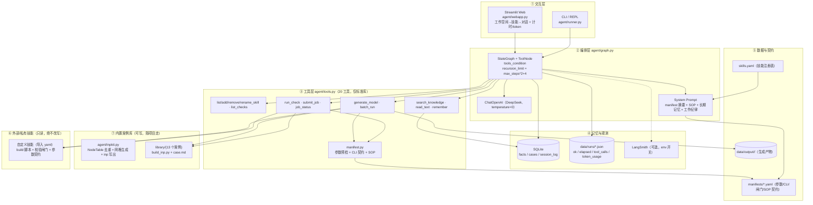
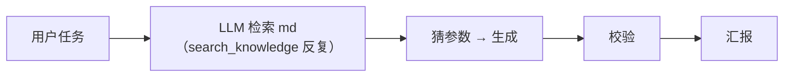
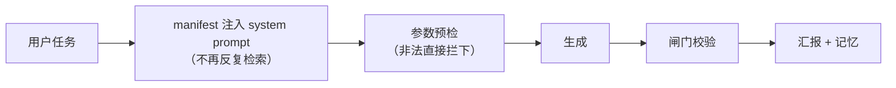

# Abaqus Agent 架构图

把「个人可用的 ReAct 脚本」升级成「可评估、可观测、可快速接入新技能的自主 harness」后的分层架构。

## 架构图（Mermaid，可在 mermaid.live 导出 PNG/SVG）

## 分层说明

| 层 | 文件 | 职责 |
|---|---|---|
| ① 交互层 | `agent/webapp.py`、`agent/runner.py`、`agent/viewer_html.py` | Streamlit 多会话界面 + CLI/REPL；记录计时与 token；网页三维预览 inp 网格 |
| ② 编排层 | `agent/graph.py` | 手搭 StateGraph + ToolNode + tools_condition；system prompt 注入 manifest 摘要、SOP、长期记忆与「工作纪律」5 条 |
| ③ 工具层 | `agent/tools.py`、`agent/manifest.py`、`agent/modeling_knowledge.py`、`agent/websearch.py` | 20 个工具，仅标准库；manifest 参数预检 + modeling_knowledge 通用建模知识 + plan_model 意图匹配 + mesh_inp/append_inp/write_inp 从零建模分步落盘 + web_search/web_fetch 联网检索，构成对话式建模 |
| ④ 记忆与观测 | `agent/memory.py`、`agent/runlog.py` | SQLite 三表长期记忆 + 结构化运行日志 + 可选 LangSmith |
| ⑤ 数据与契约 | `skills.yaml`、`manifests/*.yaml` | 技能注册表（数据）与技能契约（数据），接新技能不改代码 |
| ⑥ 外部技能项目 | 只读 | 真实参数化建模项目，工具层通过子进程调用、产物回写到 data/output |
| ⑦ 内置案例库 | `agent/inpkit.py`、`library/*` | 标准库网格生成 + 参数化案例（13 个：体/壳/梁/桁架/框架/接触/热/模态/平面应变/屈曲/弹塑性/轴对称），一键生成 inp，可扩展 |

## 现状 → 目标：manifest 化带来的变化

**现状（G4 前，ReAct）**：参数含义、可行域、CLI 契约都散在技能目录的 md 里，LLM 每次都要反复 `search_knowledge` 检索，轮次多、废话多、还不稳定。

**目标（G4 后，manifest 驱动）**：参数/CLI/闸门/SOP 以 `manifests/<skill>.yaml` 声明，启动时注入 system prompt；非法参数在生成前被预检拦下；`search_knowledge` 只作兜底。

实测效果（同 21 条评估集）：平均工具调用轮数 **1.76 → 1.19（-32%）**，成功率 90.5% → 100%。见 `evals/comparison.md`。

## 一次典型任务的数据流

1. 用户在 Web/CLI 输入自然语言任务；
2. 编排层把「manifest 摘要 + SOP + 长期记忆」注入 system prompt，LLM 决定调用哪个工具；
3. 生成类工具（generate_model/batch_run）先经 `manifest.validate_params` 预检，非法参数在 spawn 子进程前被拦截；
4. 合法参数按 manifest 的 CLI 契约（`flags` 或 `params_file`）拼命令，`subprocess` 调用只读技能项目的 build 脚本，产物写到 `data/output/<skill>/`；
5. 校验类工具（run_check）按闸门契约调用只读技能项目的 check 脚本；
6. 每次运行经 `runlog.save_run` 落盘 `data/runs/<ts>.json`，关键结论经 `remember` 写入 SQLite。

## 模型 3D 可视化（inp → 网页网格）

生成 inp 后无需 Abaqus 即可在浏览器查看三维网格：

- `agent/inp_viewer.py`：标准库解析 `*Node/*Element`，支持 S4R/C3D8R/B31/T3D2/Spring；
  体单元（六面体/四面体）做外表面剔除，instance 做平移 + 绕轴旋转展开；
- `agent/viewer_html.py`：输出内联 three.js 的单个 HTML，OrbitControls 旋转/缩放/线框/按单元类型着色。

入口：`python -m agent.viewer_html <inp>` 导出独立 HTML，或 Streamlit 侧边栏「3D 模型预览」。
实测：DEMO 模型 11.2 万节点 / 15.2 万三角，浏览器实机渲染通过。

## 导出 PNG

把上面的 Mermaid 代码粘贴到 <https://mermaid.live>，右侧即可导出 PNG/SVG（矢量）。
